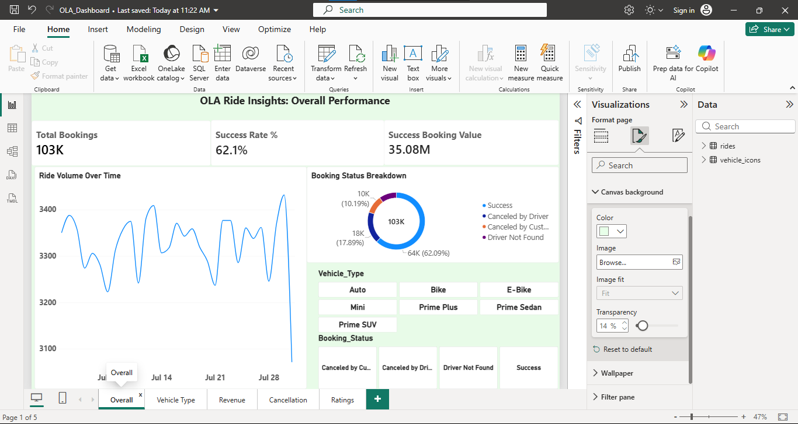
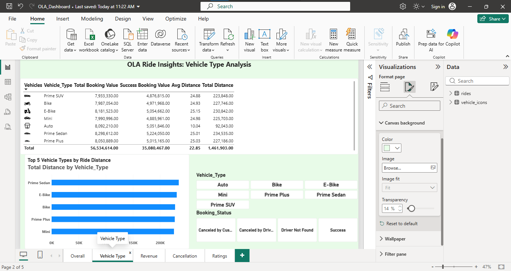
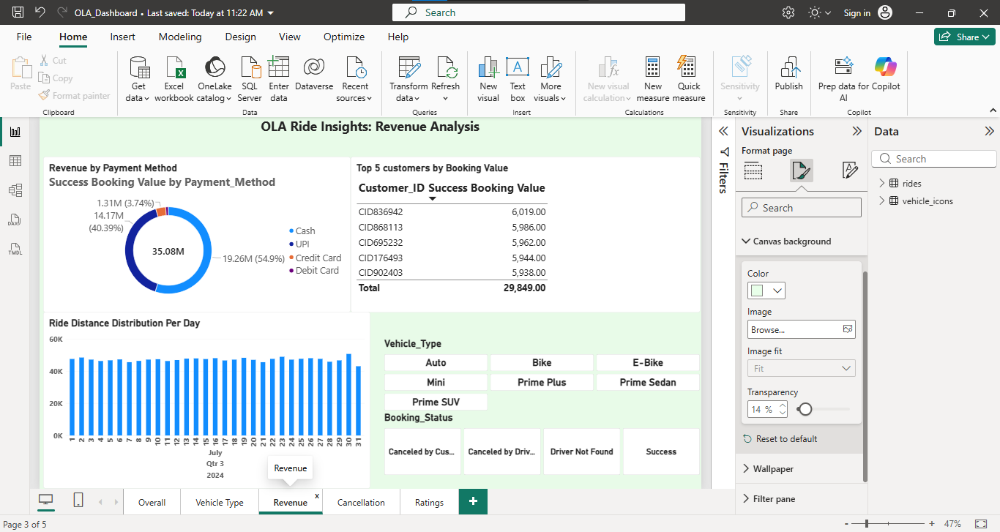
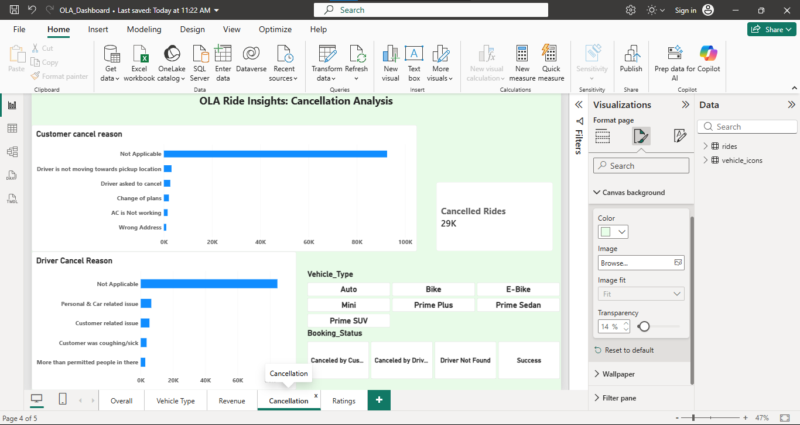
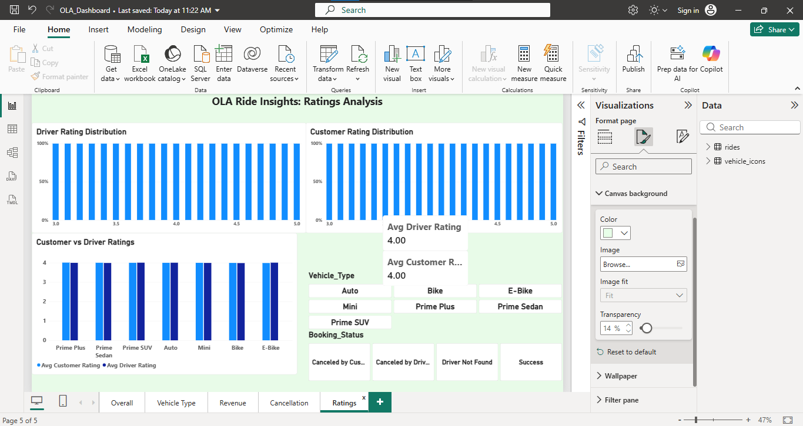

# 🚖 OLA Ride Insights

End-to-end analytics project on OLA ride-booking data (July 2024, 103,024 bookings): cleaning, SQL, Power BI dashboard and a Streamlit app.

## Project structure
```
clean_data.py          # cleaning + feature engineering, writes CSV and SQLite DB
data/ola_cleaned.csv   # cleaned dataset (used by Power BI and Streamlit)
data/ola.db            # SQLite DB (table: rides)
sql/queries.sql        # the 10 SQL questions
app/app.py             # Streamlit app
OLA_Dashboard.pbix     # Power BI dashboard (add your file)
POWERBI_GUIDE.md       # dashboard build guide
```

## How to run
```bash
pip install -r requirements.txt
python clean_data.py          # needs OLA_DataSet.xlsx in the same folder
streamlit run app/app.py
```

## Data cleaning decisions
- Missing Payment_Method, ratings and TAT values occur only on rides that never completed (39,057 rows). They are structural, so rows were **kept**.
- Text fields (cancellation/incomplete reasons, payment) were filled with `Not Applicable`. Ratings and TAT were left NULL so averages are not distorted.
- `eBike` was standardised to `E-Bike`, the `Vehicle Images` URL column was dropped, and duplicate Booking_IDs were checked (none found).
- Derived features: Hour, Day, Day_Name, Ride_Date, Is_Success.
- Revenue and distance metrics use **successful** rides only (cancelled rides have distance 0).

## SQL results (validated against pandas)
| # | Question | Result |
|---|---|---|
| 1 | Successful bookings | 63,967 |
| 2 | Avg distance | Auto 10.04 km; all others about 25 km |
| 3 | Cancelled by customers | 10,499 |
| 4 | Top customer | CID954071 (5 rides) |
| 5 | Driver cancels: personal and car issues | 6,542 |
| 6 | Prime Sedan driver rating | max 5.0, min 3.0 |
| 7 | UPI rides | 25,881 |
| 8 | Avg customer rating | about 4.0 for every vehicle type |
| 9 | Total successful booking value | ₹35,080,467 |
| 10 | Incomplete rides | 3,926 |

## Key business insights
1. **Only 62.1% of bookings succeed.** Drivers cancel 17.9% (the biggest leak), customers 10.2% and no driver is found for 9.8%. Driver-side cancellations are about 1.75 times customer-side, so driver incentives and acceptance rules are the main lever.
2. **Demand is flat across the day.** Rides per hour are close to equal (about 4.4k at peak hours 12, 15, 8, 17 and 9), so dynamic allocation matters less than reducing cancellations.
3. **Cash is still the largest payment method (about ₹19.3M, 55% of revenue)**, with UPI at about ₹14.2M (40%). Cards are under 5%, so promote UPI and cards to cut cash handling.
4. **Vehicle types perform similarly** in revenue (about ₹4.9M to 5.2M each) and cancellation rate (37% to 39%). Prime Sedan is the best performer: the highest revenue and the lowest cancellation rate (37.0%).
5. **Auto rides are short** (avg 10 km vs about 25 km for the others), which gives lower revenue per trip.
6. **Customers' top cancellation reason is "Driver is not moving towards pickup"** (3,175). A further 2,670 say the driver asked them to cancel. Both are driver-behaviour issues.
7. Ratings are uniformly about 4.0 for both drivers and customers, so ratings are not a differentiator and may be low-variance or capped.

## Dashboard screenshots











## Tech stack
Python, Pandas, SQL (SQLite/MySQL), Power BI, Streamlit, Plotly.
